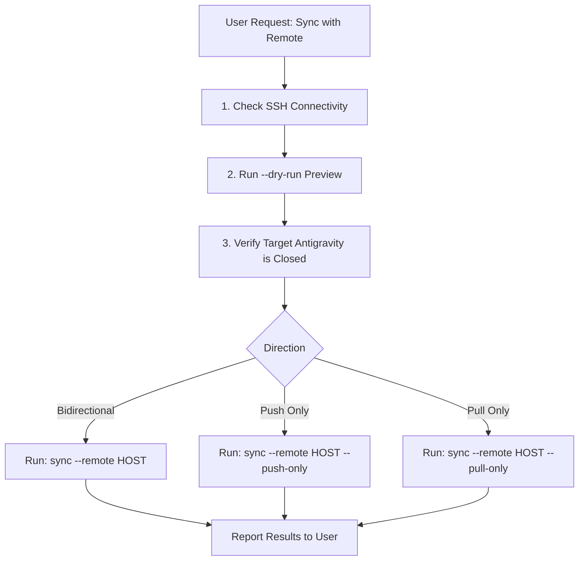

# Antigravity Sync (agy-sync)

A skill for AI agents to safely synchronize, migrate, export, import, and repair Google Antigravity (`~/.gemini/antigravity`) conversation histories across multiple machines.

## Core Capabilities

1. **Bidirectional SSH Sync (`sync`)**: Interactively or automatically syncs conversation deltas between local and remote machines. Auto-aligns workspace paths, project UUIDs, and FTS search slugs across platforms (macOS / Linux / Windows WSL).
2. **Bundle Export (`export`)**: Packages conversations, SQLite metadata, FTS5 indexes, and brain logs into a compressed, portable `.agypkg` archive.
3. **Bundle Import & Merge (`import`)**: Incrementally merges `.agypkg` archives into the target runtime using non-destructive SQLite `UPSERT` and `ATTACH` transactions, with path remapping and trajectory blob patching.
4. **Inspection & Listing (`inspect` / `list`)**: Inspects runtime health, session counts, active workspaces, or contents of `.agypkg` archives before modifying data.
5. **Metadata & Title Repair (`scripts/repair_metadata.py`)**: Fixes ungrouped or untitled sessions caused by LanguageServer rescans using pristine backups and peer snapshots.

---

## ⚠️ Mandatory Safety Rules

Before executing any write operation (`sync`, `import`, or `export` without `--force`):

1. **Target Machine Antigravity Process Check**:
   The Antigravity LanguageServer flushes in-memory SQLite state on exit and holds open WAL locks. Modifying databases on a machine while its LanguageServer runs can cause database locks or cause newly merged sessions to be overwritten when that LanguageServer exits.
   - **For Bidirectional Sync (`sync`)**: Both machines act as targets receiving writes; verify and close Antigravity on **both** machines.
   - **For One-Way Push (`--push-only`)**: The remote machine is the target; ensure remote Antigravity is closed.
   - **For One-Way Pull (`--pull-only`)**: The local machine is the target; ensure local Antigravity is closed (remote can remain running).
   - **For Bundle Import (`import`)**: Ensure local Antigravity is closed.
   - To inspect running status:
     ```bash
     python3 -m antigravity_sync inspect --local
     ```
2. **Always Run `--dry-run` First**:
   When the user requests a sync or import, run with `--dry-run` first. Present the plan (incoming sessions, outgoing sessions, path remappings, conflicts) to the user before executing the actual modification.
3. **Preserve Machine Identifiers**:
   Never overwrite or modify machine-specific installation metadata (`installation_id`, `installation_uuid`) in `conversation_summaries.db`.
4. **Automatic Backups**:
   The import command creates timestamped backups of `conversation_summaries.db` by default (`conversation_summaries.db.backup_<timestamp>`). Never pass `--no-backup` unless explicitly instructed.

---

## Command Invocation Pattern

Run commands using either the installed CLI or Python module syntax from the repository root:

```bash
# Using installed CLI:
antigravity-sync <command> [options]

# Or using Python module:
python3 -m antigravity_sync <command> [options]
```

---

## Workflows

### Workflow 1: Bidirectional SSH Sync (`sync`)

Used when both machines are reachable via SSH (e.g. laptop and workstation, local machine and cloud server).



#### Step 1: Validate Remote Connection
Test SSH access to the remote machine:
```bash
ssh -o BatchMode=yes <remote_host> whoami
```

#### Step 2: Run Dry-Run Preview
```bash
python3 -m antigravity_sync sync --remote <remote_host> --dry-run
```
Summarize the output for the user:
- Number of local vs. remote sessions
- Sessions queued to push
- Sessions queued to pull
- Detected workspace path mappings

#### Step 3: Ensure Target Antigravity is Stopped
Notify the user to close Antigravity on the target machine(s) if `inspect --local` or remote check indicates it is active.

#### Step 4: Execute Sync
```bash
# Bidirectional sync:
python3 -m antigravity_sync sync --remote <remote_host>

# One-way push (local -> remote):
python3 -m antigravity_sync sync --remote <remote_host> --push-only

# One-way pull (remote -> local):
python3 -m antigravity_sync sync --remote <remote_host> --pull-only

# Exclude temporary scratch files to save bandwidth:
python3 -m antigravity_sync sync --remote <remote_host> --no-scratch
```

---

### Workflow 2: Export to `.agypkg` Bundle (`export`)

Used when migrating sessions offline, creating backups, or sending files across air-gapped environments.

```bash
# Export all conversations:
python3 -m antigravity_sync export -o ~/conversations.agypkg

# Export conversations modified since a given date:
python3 -m antigravity_sync export --since 2026-09-01 -o ~/recent.agypkg

# Export only sessions belonging to a specific workspace:
python3 -m antigravity_sync export --workspace "my-project" -o ~/project.agypkg

# Export specific conversation UUIDs:
python3 -m antigravity_sync export --id <uuid1> --id <uuid2> -o ~/subset.agypkg

# Exclude scratch files to reduce bundle size:
python3 -m antigravity_sync export --no-scratch -o ~/clean.agypkg
```

---

### Workflow 3: Import & Merge `.agypkg` Bundle (`import`)

Used when receiving an exported `.agypkg` archive from another machine.

#### Step 1: Inspect the Bundle First
Always check what is in the bundle before importing:
```bash
python3 -m antigravity_sync inspect /path/to/bundle.agypkg
```

#### Step 2: Simulate Import (`--dry-run`)
```bash
python3 -m antigravity_sync import /path/to/bundle.agypkg --dry-run
```

#### Step 3: Run Live Import with Path & Project Remapping
When importing across different platforms or usernames (e.g. Windows `C:/Users/alice` to Linux `/home/bob`), specify `--remap-workspace`:

```bash
python3 -m antigravity_sync import /path/to/bundle.agypkg \
    --remap-workspace "C:/Users/alice/projects/demo=/home/bob/projects/demo" \
    --remap-project-id "source-project-uuid=target-project-uuid"
```

> [!NOTE]
> `--remap-workspace` and `--remap-project-id` can be specified multiple times for different project paths.

---

### Workflow 4: List and Inspect Sessions (`inspect` / `list`)

Used for diagnostics and querying conversation inventories.

```bash
# Inspect local Antigravity installation health and statistics:
python3 -m antigravity_sync inspect --local

# List 20 most recent local conversations:
python3 -m antigravity_sync list -n 20

# List sessions filtered by keyword:
python3 -m antigravity_sync list --workspace "my-project"

# List conversations stored inside a .agypkg bundle without extracting:
python3 -m antigravity_sync list -f /path/to/bundle.agypkg
```

---

### Workflow 5: Metadata & Grouping Repair

If conversations appear under "outside of project", show as "Untitled", or lose their folder hierarchy after LanguageServer startup:

1. **Verify State**:
   ```bash
   python3 scripts/verify_repair.py win <peer_snapshot.json>
   ```
2. **Create Snapshot on Peer Machine**:
   ```bash
   python3 scripts/repair_metadata.py snapshot --side mac -o mac_snapshot.json
   ```
3. **Execute Repair on Local Machine**:
   ```bash
   # Dry-run:
   python3 scripts/repair_metadata.py repair --side win --peer-snapshot mac_snapshot.json
   # Apply changes:
   python3 scripts/repair_metadata.py repair --side win --peer-snapshot mac_snapshot.json --apply
   ```

---

## Detailed References

- For complete CLI argument options and flags: see [cli-reference.md](references/cli-reference.md).
- For error resolution, WAL lock handling, and troubleshooting: see [troubleshooting.md](references/troubleshooting.md).
